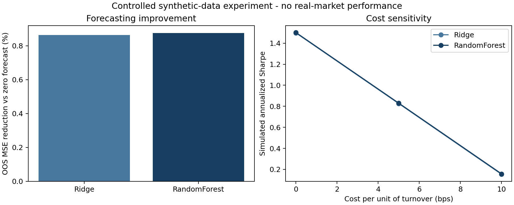

# Synthetic alpha-signal research benchmark

A reproducible research prototype comparing linear and nonlinear forecasting under weak predictability, chronological validation and transaction costs. All data are simulated. Developed with AI assistance, November 2026.

## Research question

When predictability is weak and observations are serially dependent, does a nonlinear model improve one-period-ahead return forecasting over a regularized linear baseline, and does the forecasting edge survive stylized transaction costs?

## Data and timing

All 12,000 observations are simulated locally with seed 42. Eight observable AR(1) processes have persistence from 0.25 to 0.85. The next-period return has a deliberately planted conditional mean and Gaussian noise. Noise volatility rises after observation 6,000. A ninth feature is the previous observed return.

At decision index t, the observable vector and return through t are known; the target is the return of period t+1. There are no prices, real assets or downloaded market data. The planted relationship makes this an implementation and evaluation exercise, not an alpha discovery claim.

## Protocol

- Initial development period: indices 0-3,999. Hyperparameters use train indices 0-2,998 and validation 3,000-3,999; index 2,999 is excluded.
- Ridge candidates: alpha 0.1, 1, 10 and 100. Random Forest candidates: depth 3/6, minimum leaf size 25/75, 100 trees, seed 42.
- Hyperparameter selection happens once, before outer testing. Random Forest wins initial validation MSE; both fitted model families are still reported on every outer test.
- Four chronological expanding-window tests: 4,000-5,999; 6,000-7,999; 8,000-9,999; 10,000-11,999. One row separates training and each outer test. Training expands; each test point is predicted once per model.
- Ridge scaling is fitted only on each training window. No feature selection or retuning uses outer-test results.
- Report pooled/per-fold MSE, MAE, Pearson information coefficient (IC), Spearman rank IC and a descriptive 95% circular block-bootstrap interval for pooled IC (block length 20; 1,000 draws).
- The zero-return forecast is a forecasting baseline, not an investable benchmark. Its IC is undefined, since its prediction is constant.

## Executed results

| Model | OOS MSE | Pearson IC | Spearman IC | MSE reduction vs zero |
|---|---:|---:|---:|---:|
| ZeroForecast | 0.00012604 | n/a | n/a | 0.000% |
| Ridge | 0.00012495 | 0.0947 | 0.0967 | 0.864% |
| RandomForest | 0.00012493 | 0.0953 | 0.0950 | 0.876% |

Random Forest Pearson IC interval: [0.072, 0.117]. This is uncertainty within this simulated sample. It does not imply significance in a real market or account for broad research multiple testing.

The nonlinear model's MSE improvement over Ridge is only approximately 0.012%, so this experiment provides little practical evidence for extra model complexity. The higher-volatility test blocks have lower IC; inspect fold_metrics.csv.

## Stylized positions and costs

Position = tanh(predicted return / past training-return standard deviation). Daily portfolio return = position * next-period return - cost rate * absolute position change. Fractional unit exposure is assumed, with 0, 5 and 10 basis points charged per unit of one-way turnover; the first trade and fold-boundary changes are charged. There is no leverage optimization.

For the development-selected Random Forest, annualized simulated Sharpe falls from 1.501 without costs to 0.830 at 5 bps and 0.157 at 10 bps. Annualization assumes 252 periods per year and is descriptive. This demonstrates cost sensitivity, not executable profitability.



## Limitations and next experiments

Synthetic data intentionally contain a weak predictable component. A stable planted signal, a single seed, limited hyperparameter search and a simplified execution rule make this a small controlled prototype. There is no real-market discovery, survivorship/universe problem, corporate-action treatment, borrow constraint, latency/slippage model or live model monitoring. Further work should use point-in-time market data, broader regime/seed checks, realistic costs, uncertainty around model differences and multiple-testing controls.

## Reproduce

Use Python 3.11+ and install the pinned versions in requirements.txt, then run:

```bash
python run_benchmark.py
```

The run writes results.json, metrics.csv, fold_metrics.csv, development_search.csv, cost_sensitivity.csv and out_of_sample_predictions.csv. The detailed predictions CSV is regenerated locally and excluded from version control; summary results are included. Internal checks verify prediction uniqueness, finite outputs and chronological boundaries. The notebook explains the experiment and can rerun the script. No internet connection is required after installing dependencies.
